# Volumetric Explosion FX

**VEFX · KSP 1.12.5 · Windows · MIT**

Volumetric fireballs, smoke, shock waves, nuclear detonations, visual debris, ground fires and water impacts.
Effects respond to the vessel's resources, motion and environment. BDArmory warheads are drawn too.
Visual only: gameplay, physics and sound are not changed.

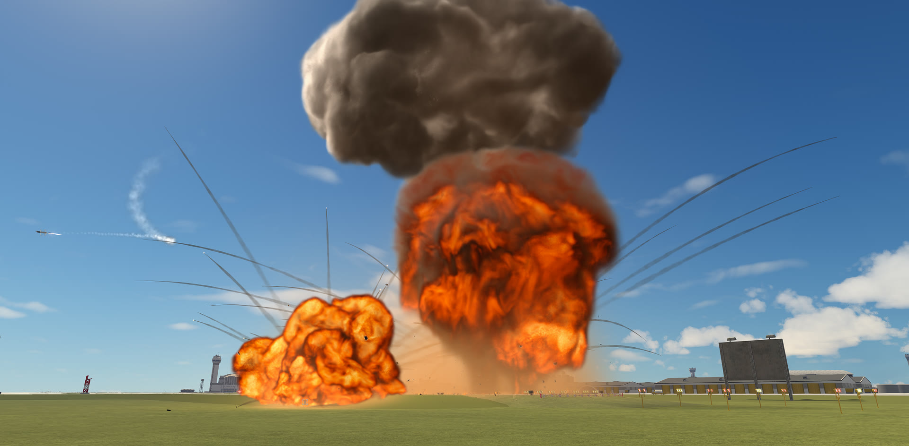

[Installation](#installation) · [What's new in 1.1](#whats-new-in-11) · [Settings](#settings) · [Screenshots](#screenshots) · [Compatibility](docs/COMPATIBILITY.md)

## In game

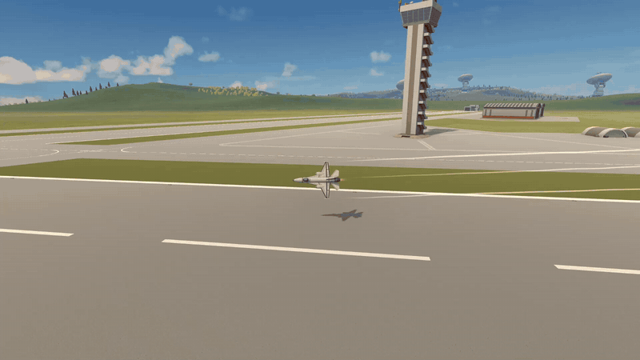

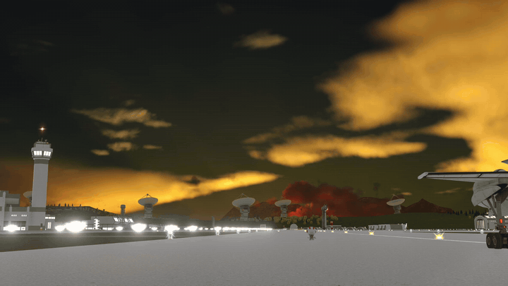

## What's new in 1.1

- Fireballs come from a baked fluid simulation. No two explosions are alike, and the impact shapes each one.
- Smoke is lit by the sun, by fires and by floodlights, and casts its shadow on the ground.
- Nuclear detonations have their own renderer: real proportions for the yield, a blinding flash, a blast wave with its
  wall of dust, condensation rings and a glowing heart at night.
- BDArmory explosions are drawn by VEFX, also for BDArmory Extended and Kerbal Powers Armory, scaled by each warhead.
- Volumetric water impacts, ground marks that differ for every blast, and wreckage cut from the destroyed part.
- A new settings window with five styles and three layouts, quick setups and a photo mode (Alt+F7).

The full list is in the [changelog](CHANGELOG.md). The 1.0 look stays available ("Compare with 1.0" in the look editor).

## Installation

1. Close KSP.
2. Extract the release ZIP and copy `VolumetricExplosionFX` into `GameData`.
3. Launch KSP. The flame toolbar button opens the settings.

No other mods are required. When updating from 1.0, replace the folder and keep
`VolumetricExplosionFX/PluginData/settings.cfg` to retain your settings.
To uninstall, remove `GameData/VolumetricExplosionFX`.

## Settings

**Ultra is the default quality.** Pick a quick setup (Cinematic, Balanced or Performance), or select High, Medium or
Low if you need better performance. The volume resolution (Full, 1/2, 1/3) and adaptive performance give finer control.
Existing saved settings take precedence over the defaults.

The window comes in five styles and three layouts. Photo mode (Alt+F7) slows down or freezes the explosions while the
game runs. The look editor, an advanced option, has 13 dials per kind of explosion. The interface follows the language
selected in KSP.

## Screenshots

| Blast wave over the space center | Air burst |
|---|---|
| 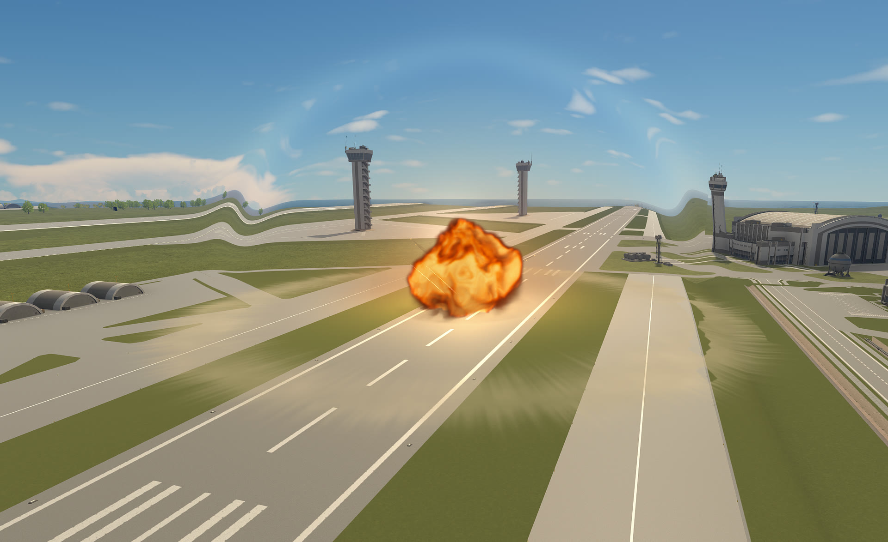 | 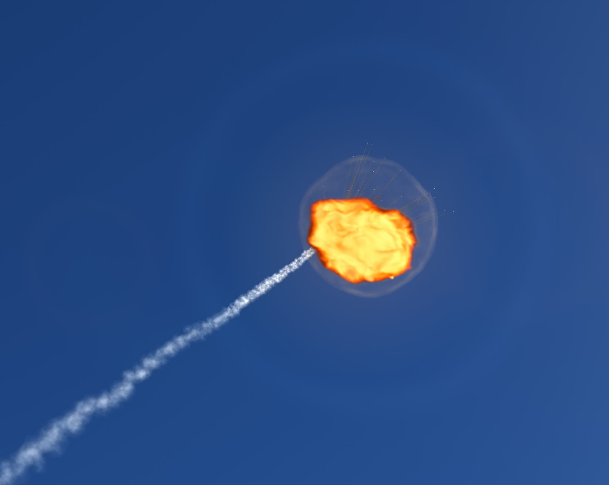 |

| Fireball from above | Breakup in flight |
|---|---|
| 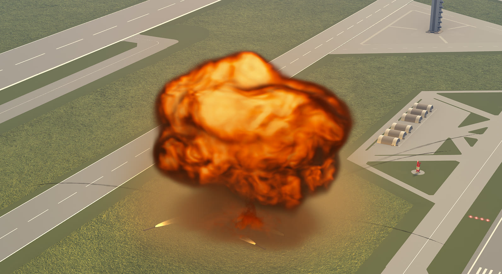 | 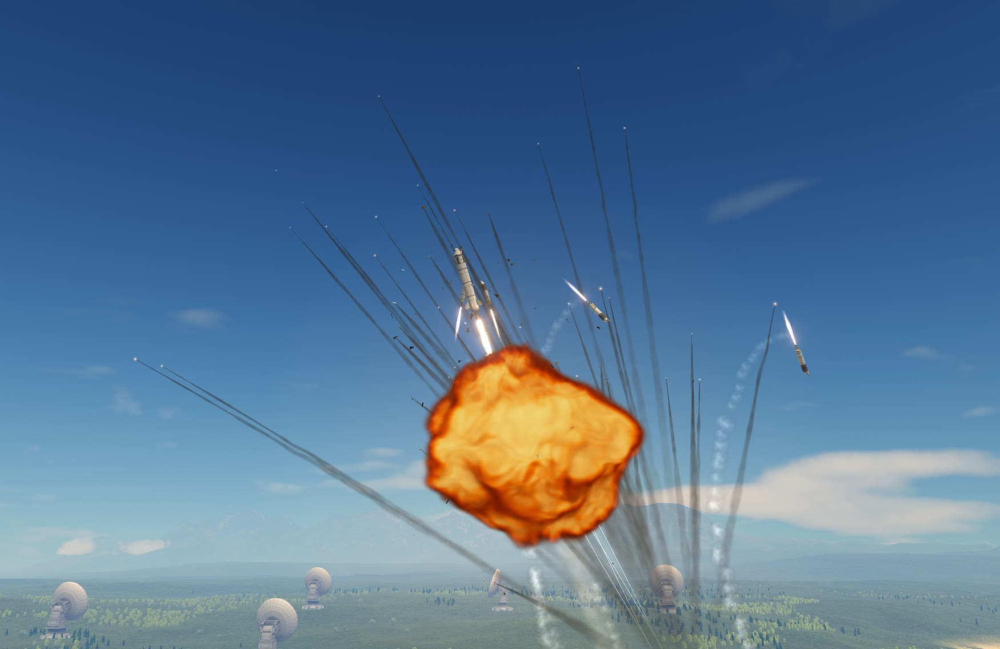 |

| Crash on the runway | Impact at sea |
|---|---|
| 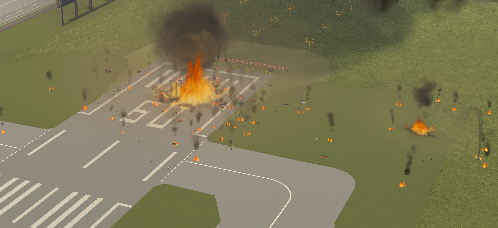 | 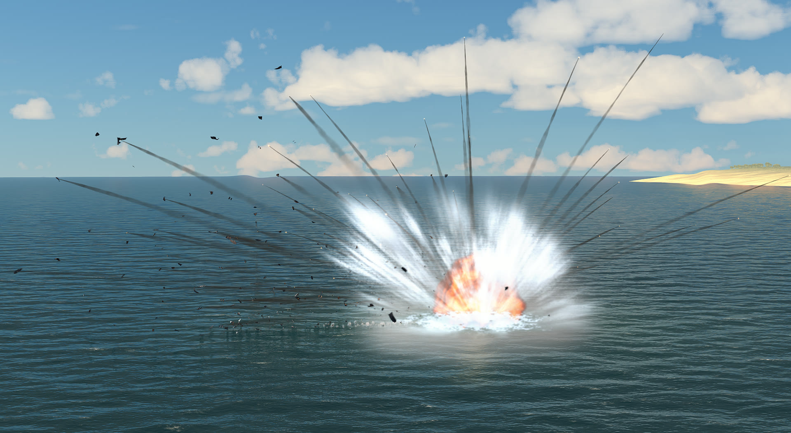 |

| Under the parachutes | Above Kerbin |
|---|---|
| 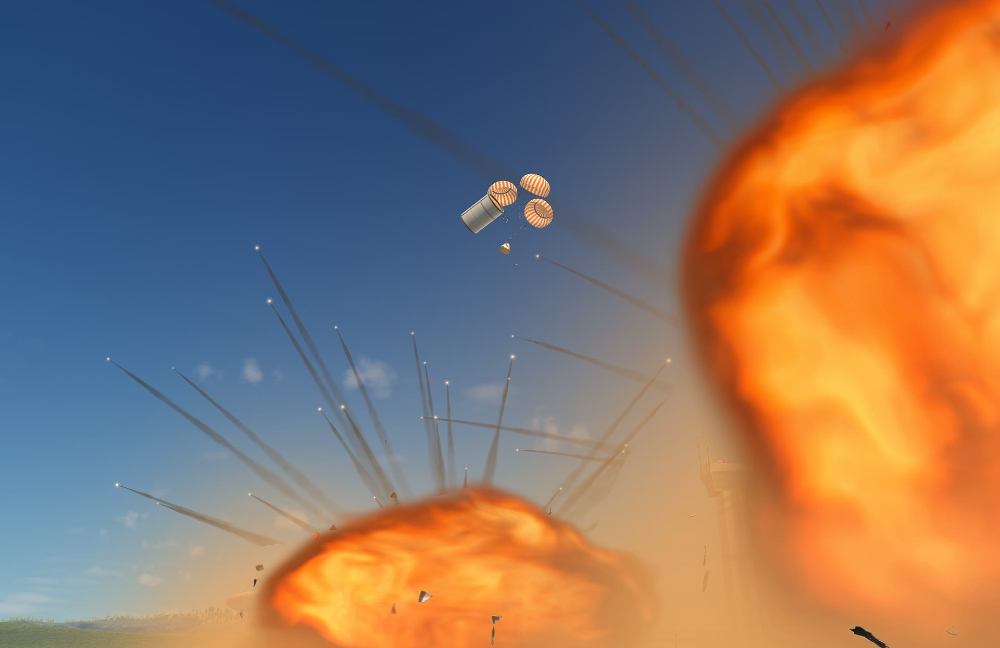 | 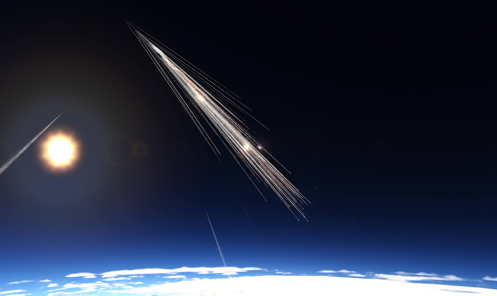 |

## Compatibility

This release is tested on **Windows with KSP 1.12.5**. macOS and Linux are not validated.
VEFX works with BDArmory, EVE, Waterfall, Parallax Continued, Scatterer, Deferred, TUFX, Kopernicus, Firefly and
SmokeScreen; the Compatibility page of the settings window shows which ones are installed.
Other explosion mods may produce overlapping effects.

[Compatibility and bug reports](docs/COMPATIBILITY.md) · [Build from source](docs/BUILD.md)

## License

[MIT](LICENSE). Copyright (c) 2026 Warnix.

Created and maintained by Warnix, with the help of AI tools.
